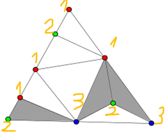
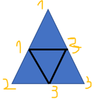
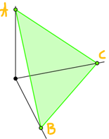
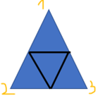

Lê Quang Thanh (Đại học Wollongong, Úc)<a href="#_ftn1" id="_ftnref1">[1]</a>

Lê Văn Cường (Trường kinh tế Paris, Pháp)<a href="#_ftn2" id="_ftnref2">[2]</a>

Phạm Ngọc Sáng (Trường Kinh doanh Normandie, Pháp)<a href="#_ftn3" id="_ftnref3">[3]</a>

<strong>[Link để tải file PDF của bài viết](https://www.dropbox.com/s/r53kiudnmeklowq/General_equilibrium_Sperner_lemma.pdf?dl=0)</strong>

<strong>Tóm tắt (phiên bản facebook) </strong>: Mùa hè nóng nực, ta có thể uống bia để giải khát và chém gió cho mát. Nhưng ta cũng nên có những câu chuyện mang tính học thuật sâu sắc 1 chút. Bài viết sau đây cố gắng bắc 1 cái cầu giữa toán học tổ hợp và bàn tay vô hình trong kinh tế học. Hi vọng rằng học sinh cấp 3 cũng có thể hiểu được ý tưởng của vấn đề này.

<strong>Tóm tắt (phiên bản khoa học) </strong>: Chúng tôi sử dụng Bổ đề Sperner (là 1 kết quả về đánh số màu các đa diện trong lĩnh vực toán tổ hợp) để chứng minh Bổ đề Gale-Nikaido-Debreu, từ đó suy sự tồn tại của bàn tay vô hình trong một nền kinh tế thị trường tự do. Đây là kết quả chính trong bài báo “A Direct Proof of the Gale–Nikaido–Debreu Lemma Using Sperner’s Lemma” vừa được đăng trên tạp chí “Journal of Optimization Theory and Applications”. Link để đọc miễn phí bài báo: [https://rdcu.be/cRFbC](https://eur01.safelinks.protection.outlook.com/?url=https%3A%2F%2Frdcu.be%2FcRFbC&data=05%7C01%7Cnpham%40em-normandie.fr%7C881ca09aa62f4cfc42f308da66096dcf%7Cdffef3d7143e41ed815d9c383c48eb95%7C1%7C0%7C637934487928092804%7CUnknown%7CTWFpbGZsb3d8eyJWIjoiMC4wLjAwMDAiLCJQIjoiV2luMzIiLCJBTiI6Ik1haWwiLCJXVCI6Mn0%3D%7C3000%7C%7C%7C&sdata=85AIKru1GgpIsutH2jaEJmsX7AH%2FpLiH7Em%2BV4ttRwI%3D&reserved=0) hoặc ở đây <https://link.springer.com/article/10.1007/s10957-022-02067-2>

<strong>Bàn tay vô hình và Bổ đề Gale-Nikaido-Debreu</strong>

Bàn tay vô hình (Invisible hand) là một trong những khái niệm kinh điển nhất của kinh tế học, được nhà kinh tế học Adam Smith đưa ra vào năm 1776. Ý tưởng của bàn tay vô hình như sau : trong nền kinh tế thị trường tự do, ngay cả khi các cá thể kinh tế (như người tiêu dùng, doanh nghiệp, …) chỉ quan tâm đến lợi ích của họ, mà không cần quan tâm đến lợi ích chung, nền kinh tế vẫn vận hành hiệu quả. Tại sao từ lợi ích riêng lại tạo ra sự hiệu quả chung cho cả nền kinh tế ? Phải chăng là có 1 bàn tay vô hình nào đó nhào nặn ra chuyện này ? Và nếu có, thì bàn tay vô hình này hình dạng ra sao (mềm mại hay thô ráp? có đúng là mười ngón thiên thần không? 😀 … ) ?

Một cách tiếp cận khoa học để trả lời những câu hỏi này là tìm cách đưa những khái niệm và các mối quan hệ kinh tế vào trong 1 khuôn khổ nào đó (như kiểu xây dựng bản đồ) mà ở đó ta có thể hiểu vấn đề dễ dàng hơn.  Gérard Debreu, người được trao giải Nobel kinh tế năm 1983, có công rất lớn trong việc tạo ra những khuôn khổ này bằng cách dùng ngôn ngữ toán học để mô hình hóa hành vi của những cá thể và các tương tác kinh tế, từ đó giúp ta hiểu rõ hơn nhiều vấn đề quan trọng trong kinh tế học. Bàn tay vô hình chính là 1 hệ thống giá của các mặt hàng mà với giá này, các cá thể kinh tế đã tìm được lựa chọn tốt nhất có thể của họ và, hơn nữa, cầu không vượt quá cung (hoặc cung và cầu bằng nhau) trên tất cả các thị trường. Hệ thống giá này được gọi là giá cân bằng (equilibrium prices). Quan trọng hơn nữa, khi nền kinh tế ở điểm cân bằng, sự phân phối nguồn lực và tài sản được chứng minh là tối ưu theo nghĩa Pareto, tức là không tồn tại phân phối nào mà độ hài lòng của tất cả đều không giảm và có ít nhất 1 người hài lòng hơn hẳn. Đây chính là nội dung của Định lý Thứ nhất về Phúc lợi Xã hội. Tuy nhiên, sự tối ưu này không phải lúc nào cũng đạt được.

Hệ thống giá (tức bàn tay vô hình) này đến từ đâu?  Chứng minh sự tồn tại của hệ thống giá cân bằng chính là chứng minh sự tồn tại của bàn tay vô hình. Đây là 1 chủ đề được thảo luận rất sôi nổi trong nửa sau thế kỷ 20, được minh chứng bằng rất nhiều bài báo chuyên ngành về chủ đề này đăng ở những tạp chí kinh tế hàng đầu. Chú ý rằng ta có thể chứng minh sự tồn tại của bàn tay vô hình trong nhiều mô hình kinh tế. Tuy nhiên, khi thị trường không hoàn hảo thì bàn tay vô hình có thể không tồn tại.

Một trong những cách để chứng minh sự tồn tại của giá cân bằng là dung cách tiếp cận tổng cầu thặng dư (Excess demand) – tức là hiệu giữa tổng cầu và tổng cung của 1 thị trường. Khi đó, vấn đề được quy về chứng minh 1 kết quả được gọi là Bổ đề Gale-Nikaido-Debreu, mang tên của 3 nhà kinh tế học David Gale, Hukukane Nikaido và Gérard Debreu. Cả 3 kinh tế gia nổi tiếng này cũng đồng thời có năng lực và kiến thức toán học đặc biệt xuất sắc.

Bổ đề Gale-Nikaido-Debreu đã được chứng minh bằng nhiều cách khác nhau nhưng nói chung đều dựa trên các định lý điểm bất động (ví dụ như định lý điểm bất động Kakutani, định lý điểm bất động Brouwer).

Debreu đã đặt câu hỏi là có cách nào chứng minh Bổ đề Gale-Nikaido-Debreu mà không dùng định lý điểm bất động không ? Đây chính là chủ đề của 1 bài báo gần đây của chúng tôi (gồm Lê Văn Cường ở Trường kinh tế Paris, Cagri Saglam ở Đại học Bilkent, Lê Quang Thanh ở Đại học Wollongong, và Phạm Ngọc Sáng ở Trường Kinh doanh Normandie). Trong bài báo, chúng tôi chứng minh Bổ đề Gale-Nikaido-Debreu một cách trực tiếp từ Bổ đề Sperner.

<strong>Bổ đề Sperner là gì ?</strong>

Bổ đề Sperner là 1 kết quả nổi tiếng trong lĩnh vực toán tổ hợp, nói về cách tô màu các đỉnh của 1 đa diện và các đa diện con. Sperner công bố bài báo về Bổ đề Sperner năm 1928, khi ông mới 23 tuổi.

Để dễ hiểu Bổ đề Sperner, ta xét trường hợp tam giác trong không gian hai chiều. 1 tam giác có thể được chia nhỏ (1 cách khéo léo) thành nhiều tam giác nhỏ, như hai hình dưới đây. Bây giờ ta sẽ dùng 3 màu khác nhau (gọi là 1, 2, 3) để tô màu các đỉnh của tất cả các tam giác lớn và nhỏ. Bổ đề Sperner nói rằng, nếu cách tô màu thỏa mãn điều kiện Sperner, tức là 2 điều kiện sau, thì sẽ tồn tại ít nhất 1 tam giác nhỏ mà 3 đỉnh được tô bởi 3 màu khác nhau :

- Điều kiện 1 : Ba đỉnh của tam giác to ban đầu được tô bởi 3 màu khác nhau.
- Điều kiện 2 : Các đỉnh (bao gồm cả đỉnh của tam giác to và các tam giác nhỏ) nằm trên 1 cạnh của tam giác to chỉ được tô bởi 2 màu (chính là 2 màu ở hai đầu mút của cạnh đó).  

Ta sẽ gọi tam giác con được tô màu đầy đủ nếu ba đỉnh được tô bới 3 màu khác nhau.

 

Trong hình trên bên trái, ta thấy rằng có 3 tam giác nhỏ được tô màu đầy đủ (các màu được gọi là 1, 2, 3). Hình bên phải, tam giác con ở góc bên trái được tô màu đầy đủ.

Các bạn có thể dựa vào kết quả này để tạo 1 trò chơi với các bạn nhỏ (từ 10 tuổi, thậm chí 7 tuổi, trở nên, kể cả người lớn). Cách chơi như sau : Ta vẽ hình như trên và đánh số  1, 2, 3 cho 3 đỉnh của tam giác to. Sau đó ta giải thích hai điều kiện trên, và đố người đánh số các điểm trên cạnh của tam giác to thế nào mà ta không tìm được tam giác nhỏ được tô màu đầy đủ. Nếu ta tìm được tam giác như vậy thì ta thắng. Dĩ nhiên là ta luôn thắng vì Bổ đề Sperner luôn chính xác 😀

<strong>Từ Bổ đề Sperner đến bàn tay vô hình và Bổ đề Gale-Nikado-Debreu</strong>

Trường hợp nền kinh tế có 3 hàng hóa có thể coi như không gian ba chiều. Trong trường hợp này, một hệ thống giá (ở đây ta có 3 giá của 3 hàng hóa khác nhau) chính là tọa độ của 1 điểm trong không gian. Điều thú vị là ta có thể dùng Bổ đề Sperner, tức là từ sự tồn tại của cách tô màu đầy đủ, để suy ra sự tồn tại của 1 hệ thống giá cân bằng, hay nói cách khác, chính là sự tồn tại của bàn tay vô hình.

Năm 1982, Herbert Scarf đã dùng Bổ đề  Sperner để chứng minh sự tồn tại của 1 hệ thống giá cân bằng trong 1 mô hình kinh tế trao đổi mà ở đó nhu cầu của người tiêu dùng là 1 hàm số.

Ta sẽ mô tả sơ lược ý tưởng như sau. Mỗi 1 điểm trong không gian tương ứng với 1 vector giá P=(P1,P2,P3). Ta có thể giả sử P1+P2+P3=1 (vì nếu không, ta có thể xét Pi/(P1+P2+P3) thay cho Pi, với i=1,2,3). Như vậy, tập hợp tất cả các giá sẽ nằm trên 1 tam giác ở trong không gian như hình sau. Tam giác như vậy được gọi là 1 đơn hình.

Với giá P cho trước, ta sẽ có hàm cầu, tức là nhu cầu của người tiêu dùng phụ thuộc vào giá. Từ định luật Walras, ta có P1\*Z1+P2\*Z2+P3\*Z3=0, ở đó Z1, Z2, Z3 là tổng cầu thặng dư của hàng hóa 1, 2 và 3 (ý nghĩa của luật Walras rất đơn giản : tổng số tiền dùng để mua hàng bằng tổng số tiền thu được khi bán hàng). Bây giờ ta chia tam giác to 123 như hình sau thành 4 tam giác nhỏ. Ta đánh số 3 điểm ở giữa các cạnh của tam giác như sau: với điểm P=(P1,P2,P3), ta đánh số của điểm này là số i nào đó (i có thể lấy giá trị 1, 2, hoặc 3)  sao cho Pi khác không và Zi \<= 0. Nhờ Định luật Walras, số i này lúc nào cũng tồn tại.

Dùng Bổ đề Sperner, ta sẽ tìm được 1 tam giác nhỏ được đánh số đầy đủ tức là Zi(P)\<=0 với P là đỉnh bất kỳ của tam giác này, và với mọi i=1,2,3. Sau đó ta lại chia nhỏ tam giác nhỏ này. Ta lại tìm được 1 tam giác nhỏ hơn mà là Zi(P)\<=0 với P là đỉnh bất kỳ của tam giác nhỏ hơn này. Cứ tiếp tục như vậy, ta tìm được 1 dãy các tam giác lồng vào nhau mà Zi(P)\<=0 với P là đỉnh bất kỳ của các tam giác này.  Dãy tam giác lồng vào nhau nhau này sẽ tiến đến 1 điểm nào đó ta gọi là P\*. Và điểm này sẽ thỏa mãn Zi(P\*)\<=0 với mọi i=1,2,3. Điều này có nghĩa là tổng cầu không vượt quá tổng cung ở trên tất cả các thị thường. Như vậy, P\* chính là 1 giá cân bằng, tức là bàn tay vô hình.

Tuy nhiên, ta phải làm thế nào khi nhu cầu của người tiêu dùng là một hàm đa giá trị (tức là họ có thể có nhiều lựa chọn tối ưu, như ăn 2 quả táo, 1 quả cam thì cũng vui như ăn 2 quả cam và 1 quả táo) ? Trong bài báo gần đây của chúng tôi, chúng tôi đi xa hơn bằng cách dùng Bổ đề Sperner để chứng minh Bổ đề Gale-Nikaido-Debreu, từ đó suy ra sự tồn tại của 1 hệ thống giá cân bằng trong rất nhiều mô hình kinh tế (bao gồm cả nền kinh tế trao đổi) mà ở đó nhu cầu của các cá thể kinh tế là hàm đa giá trị.

Bổ để Gale-Nikaido-Debreu được phát biểu nôm na như sau: Nếu ta có P1\*Z1+P2\*Z2 + … + Pn\*Zn\<=0 với (Z1,Z2,…, Zn) là 1 giá trị bất kỳ của hàm đa trị Z(P), và với mọi P nằm trong 1 đơn hình (là 1 sự tổng quát tự nhiên của tam giác cho không gian nhiều chiều), và hàm đa trị Z thỏa mãn 1 vài điều kiện khác, thì sẽ tồn tại 1 giá P\*=(P1\*,P2\*,…, Pn\*) khác 0 sao cho Z1(P\*)\<=0, Z2(P\*)\<=0, …, Zn(P\*)\<=0, tức là tổng cầu thặng dư không vượt quá 0, hay nói cách khác tổng cầu không vượt quá tổng cung, trên tất cả các thị trường. Từ đó suy ra giá P\* chính là giá cân bằng.

Ý tưởng của chúng tôi cũng khá tự nhiên: thay vì xét hàm đa trị, ta sẽ làm với rất nhiều hàm số đơn trị. Bước đầu tiên là ta sẽ bao phủ đơn hình (trường hợp đặc biệt là tam giác trong không gian 3 chiều) bởi 1 số những hình cầu nhỏ với bán kính R. Từ những hình cầu nhỏ này và hàm đa trị Z, ta xây dựng nhiều hàm đơn trị. Với hàm đơn trị này và Định luật Walras, ta sẽ dùng Bổ để Sperner để chứng minh sự tồn tại 1 hệ thống giá P\*(R) phụ thuộc vào bán kính R sao cho tổng cầu thặng dư sẽ nhỏ hơn 1 đại lượng tỷ lệ thuận với bán kính R. Bước cuối cùng là khi R tiến về 0, thì giá P\*(R) sẽ tiến về 1 giá P\* chính là giá cân bằng. Chi tiết chứng minh thế nào thì mời các bạn xem bài của chúng tôi ở địa chỉ sau : <https://rdcu.be/cRFbC> hoặc ở đây <https://link.springer.com/article/10.1007/s10957-022-02067-2> Bài báo phiên bản chính thức thì viết gắn gọn tại vì nhiều chuyện không mới thì chúng tôi không đưa vào bài.

Cách tiếp cận nhờ vào Bổ để Sperner đã được Scarf phát triển thành 1 thuật toán để tìm điểm cân bằng, từ đó tìm và hiểu được bàn tay vô hình trong một số mô hình kinh tế. Tuy nhiên, vấn đề tìm và hiểu tất cả các điểm cân bằng trong các mô hình kinh tế, đặc biệt là khi có nhiều thị trường và một trong số chúng không hoàn hảo, vẫn là một câu hỏi chưa có câu trả lời đầy đủ.

<strong>Thông tin một vài bài báo</strong>:

Le, T., Le Van, C., Pham, NS., Sagri, S<em>.</em> A Direct Proof of the Gale–Nikaido–Debreu Lemma Using Sperner’s Lemma. <em>J Optim Theory Appl</em> <strong>194, </strong>1072–1080 (2022).    

Scarf, H. (1982), The Computation of Equilibrium Prices: An Exposition. In Handbook of Mathematical Economics, Volume II, eds. K. Arrow and Alan Kirman, chapter 21.

Sperner, E.: Neuer Beweis fur die Invarianz der Dimensionszahl und des Gebietes. Abh. Math. Semin. Univ. Hambg. 6, 265–272 (1928).

------------------------------------------------------------------------

<a href="#_ftnref1" id="_ftn1">[1]</a> Email : <thanhl@uow.edu.au>

<a href="#_ftnref2" id="_ftn2">[2]</a> Email : <Cuong.Le-Van@univ-paris1.fr>

<a href="#_ftnref3" id="_ftn3">[3]</a> Email : <npham@em-normandie.fr>, website: [https://phamns.wordpress.com/](/)
